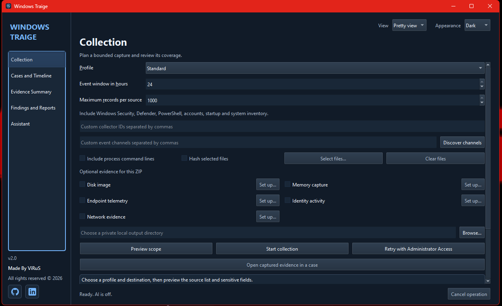
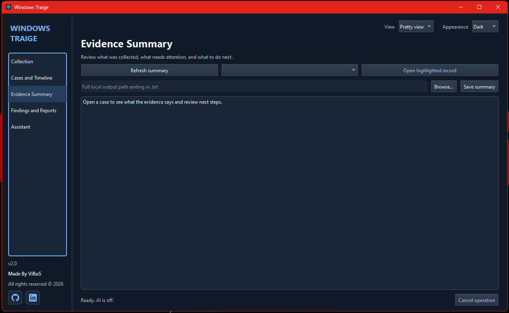
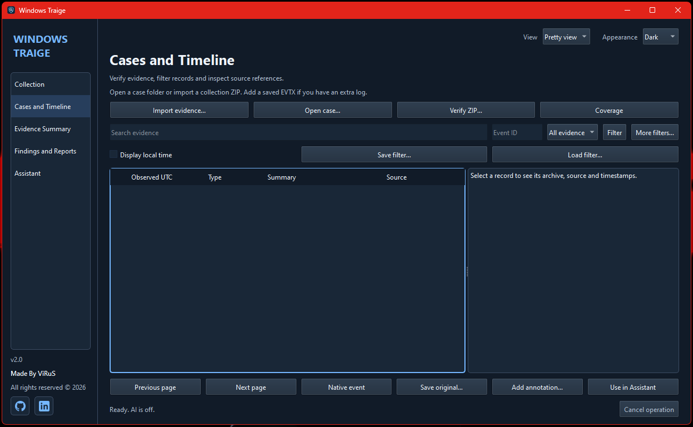
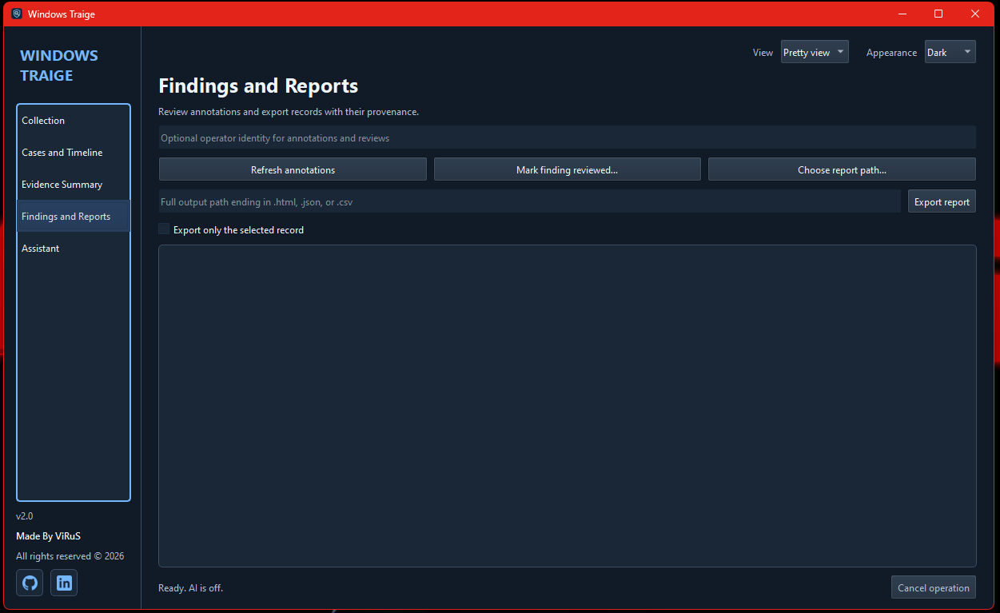
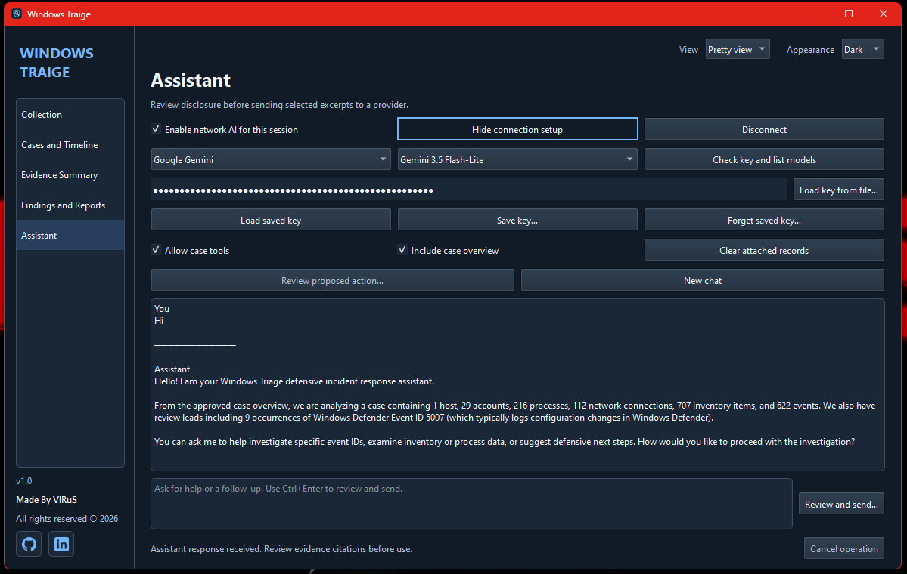
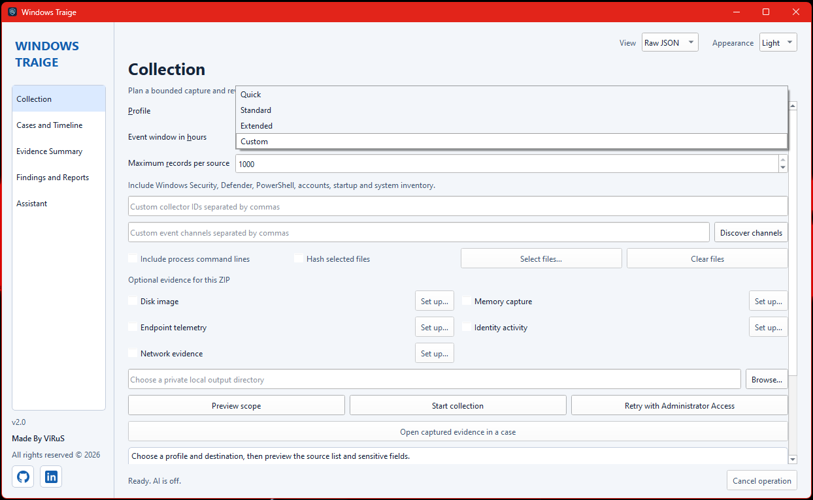

# 🚀Windows Traige🚀

**AI Powered Incident Response and Forensics Software**

Windows Traige is a Windows desktop and command-line workbench for incident triage and digital forensics. Collect authorized Windows evidence, add files supplied by an IT team or another tool, and review everything in one case. The optional AI assistant helps interpret selected excerpts. Collection, verification, search, and reporting work offline.

[Download v2.0](https://github.com/The-Real-Virus/Windows-Traige/releases/download/v2.0/WindowsTraige-v2.0-win-x64.zip) · [SHA-256 checksum](https://github.com/The-Real-Virus/Windows-Traige/releases/download/v2.0/WindowsTraige-v2.0-win-x64.zip.sha256) · [Release page](https://github.com/The-Real-Virus/Windows-Traige/releases/tag/v2.0) · [User handbook](Documentation.docx)

## What it does

- **Collect Windows evidence.** Choose Quick, Standard, Extended, or Custom. Preview the sources and time window before collection. Coverage records unavailable, denied, and partial sources.
- **Package and verify evidence.** One ZIP holds the collected records, supported supplemental originals, and a manifest with SHA-256 hashes. Large originals can use ZIP64. A separate SHA-256 file verifies the ZIP itself.
- **Investigate a case.** Import a Windows Traige ZIP or a saved Windows Event Log (`.evtx`). Search the timeline, review source coverage, add findings, export reports, and save verified working copies of supplemental originals.
- **Review with AI.** Gemini passed live tests using synthetic evidence. The assistant starts disabled and previews each outgoing request so you can choose what to share.

## Download and run

1. Download the Windows x64 ZIP and its checksum from the links above. GitHub also provides a source ZIP from the tag for developers.
2. Verify the downloaded ZIP from PowerShell in your download folder.

   ```powershell
   $name = 'WindowsTraige-v2.0-win-x64.zip'
   $expected = ((Get-Content -LiteralPath "$name.sha256" -Raw).Trim() -split '\s+')[0]
   $actual = (Get-FileHash -LiteralPath $name -Algorithm SHA256).Hash
   if ($actual -ne $expected) { throw 'The ZIP checksum did not match.' }
   $actual
   ```

3. Extract the whole ZIP to a private local folder. Keep `_internal` and `_cli_runtime` alongside `WindowsTraige.exe` and `WindowsTraige.Cli.exe`.
4. Start `WindowsTraige.exe` with standard permissions. Python and Qt are included in the portable package.

The portable package is for Windows x64. The packaged desktop and CLI were verified on Windows 11 Pro 22H2 x64 build 22621.4317. The executables are unsigned. Additional Windows versions and physical write-blocker tests are in [Future Work](Source%20code/docs/futurework.md). [Verification record](Source%20code/docs/verification.md)

## Collect and open your first case

1. Open **Collection** and choose a private output folder. Use **Quick** for a small capture or **Standard** for broader Windows evidence.
2. Choose **Preview scope**, then **Start collection**. Read **Coverage** for any missing or limited sources. The ZIP and its checksum are saved together.
3. Choose **Open captured evidence in a case**, select a case folder, and choose **Verify and import**.
4. Open **Evidence Summary** to see what was collected and where coverage is incomplete. Use **Cases and Timeline** to review records and add annotations. Use **Findings and Reports** to review findings or export reports.

The app reads the selected sources. Running a collector on Windows can create ordinary Windows activity records. Keep evidence ZIPs, reports, and original files in access-controlled storage.

## Add files from other tools

Check an optional source in **Collection**. Choose **Set up → Browse**, select the file, and choose **OK**. **Show optional details** lets you add who collected it, where it came from, and a separately supplied checksum. A normal Windows capture needs none of these extra files.

| Option | What to provide |
|---|---|
| Disk image | An existing raw `.dd`, `.img`, or `.raw` image. The guided offline record captures details from an acquisition performed with an approved external tool. |
| Memory capture | An existing raw `.raw` or `.mem` dump from an authorized responder. |
| Endpoint telemetry | A Defender XDR `DeviceEvents` CSV with `Timestamp`, `DeviceId`, `DeviceName`, `ActionType`, and `ReportId`. |
| Identity activity | A Microsoft Entra sign-in JSON array or a Microsoft Graph export with a `value` array. |
| Network evidence | A saved `.pcap` or `.pcapng`. The case indexes supported timestamped TCP and UDP metadata and preserves the original capture. |

The handbook explains when to use each option, what to put in every setup field, and how to use the case controls. [Read the handbook](Documentation.docx)

## Try it from PowerShell with synthetic evidence

Run these commands from the extracted application folder. The fixture is a made-up investigation you can use without collecting evidence from your computer.

```powershell
.\WindowsTraige.Cli.exe --version
New-Item -ItemType Directory -Force .\Practice | Out-Null
$fixture = .\WindowsTraige.Cli.exe fixture --out .\Practice | ConvertFrom-Json
.\WindowsTraige.Cli.exe verify $fixture.archive --checksum $fixture.checksum
.\WindowsTraige.Cli.exe import $fixture.archive --case .\Practice\Case --checksum $fixture.checksum
.\WindowsTraige.Cli.exe query .\Practice\Case --event-id 7045
.\WindowsTraige.Cli.exe summary .\Practice\Case
```

Run `WindowsTraige.Cli.exe --help` or `WindowsTraige.Cli.exe collect --help` for command options.

## Build and test from source

Use Windows x64, PowerShell 7, and CPython 3.12.14 AMD64 with pip and venv. From the repository root, enter `Source code` and follow the build guide to select Python and download the hash-pinned wheels. Use a new build ID and test ID for later runs. [Full build instructions](Source%20code/docs/build.md)

```powershell
Set-Location 'Source code'
# Set $Python and populate environment/wheels using the build guide.
.\scripts\Build.ps1 -Python $Python -BuildId local-v2-001 -Fresh
.\scripts\Verify.ps1 -BuildId local-v2-001 -RunId local-v2-smoke
$env:PYTHONPATH = (Resolve-Path src).Path
$env:WINDOWSTRAIGE_TEST_ROOT = (New-Item -ItemType Directory -Force artifacts/qa/fixtures).FullName
& .\environment\build-local-v2-001\Scripts\python.exe -B -m unittest discover -s tests -v
```

The build writes the portable ZIP, detached checksum, executable hashes, and source manifest under `artifacts/builds`. The packaged smoke test checks an extracted copy and writes its results under `artifacts/qa`. The source suite contains 21 tests.

## Project structure

```text
Windows-Traige/
├── README.md
├── Documentation.docx
└── Source code/
    ├── src/windows_traige/     Desktop, CLI, and evidence processing
    ├── packaging/             PyInstaller entries and dependency lock
    ├── scripts/               Build, verification, and handbook tools
    ├── fixtures/              Synthetic evidence
    ├── tests/                 Automated tests and benchmark
    ├── docs/                  Build, evidence schema, verification, and future work
    └── source-files.sha256     Approved application source manifest
```

Windows binaries and runtime notices are delivered through [GitHub Releases](https://github.com/The-Real-Virus/Windows-Traige/releases). See the [architecture](Source%20code/docs/architecture.md), [evidence schema](Source%20code/docs/evidence-schema.md), and [third-party notices](Source%20code/docs/third-party.md).

## Set up the optional assistant

Open **Assistant** and choose a provider and model. Enter your own API key or use **Load key from file**, then enable network AI for the session. Review the exact request and approved evidence excerpts before sending. Keep keys and private case material out of Git. [Provider setup and disclosure](Source%20code/docs/providers.md)  

## VISUAL APPLICATION  













## Contribution and Future Work

Use a synthetic example when reporting a problem. Include the Windows build, application version, steps to reproduce, and observed result. [Report an issue](https://github.com/The-Real-Virus/Windows-Traige/issues)

The two deferred checks are **Acquisition safety (20%)** and **Release handoff (15%)** from the original validation plan. They cover physical write-blocker testing and the remaining Windows compatibility matrix. [Future Work](Source%20code/docs/futurework.md) · [Verification record](Source%20code/docs/verification.md)

Made By ViRuS · All rights reserved © 2026  
[GitHub](https://github.com/The-Real-Virus) · [LinkedIn](https://www.linkedin.com/in/syed-muhammad-shah)
